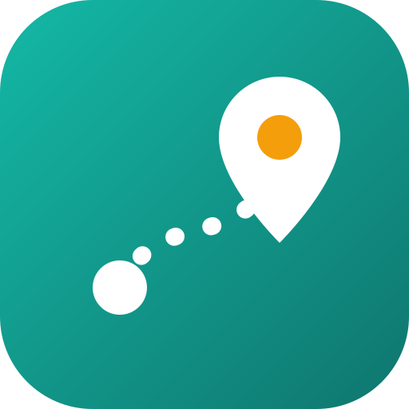

<p align="center">
    
</p>

<h3 align="center">
가고 싶은 곳을 모아 날짜별 동선으로 짜 주는 개인 여행 계획 앱
</h3>

<p align="center">
| <a href="./CONTRIBUTING.md"><b>Contributing</b></a> | <a href="./CLAUDE.md"><b>Agent Guide</b></a> | <a href="./docs/PLAN.md"><b>Plan</b></a> |
</p>

---

`dongseon`(동선)은 한 가구가 집 Mac에서 띄워 쓰고, 여행 중에는 휴대폰으로 접속하는 여행 계획 앱입니다. 가고 싶은 곳(핀)을 모으고, 핀 위치를 기준으로 숙소 동네와 항공편 후보를 비교하고, 영업시간·휴무·이동시간을 지키는 날짜별 동선을 만듭니다. 첫 사용처는 연말 도쿄 여행입니다.

> 일정의 시각은 모두 추정입니다. 영업 정보는 출처와 확인일을 함께 보여 주며, 연휴 기간에는 직접 확인이 필요합니다.

## ✨ 기능 (계획)

- **장소**: Google 검색·자동완성, 공유 URL 붙여넣기, Google Takeout "저장됨" 리스트 가져오기, 우선순위(must / want / maybe)와 체류시간
- **숙소**: 핀까지의 가중 평균 이동시간으로 동네 순위, 후보 숙소 비교
- **항공**: 후보별 현지 가용 시간과 총비용 비교 (검색은 Google Flights 등에서 직접)
- **일정**: OR-Tools로 영업시간·예약·식사 시간을 지키는 초안, 경고 배지, 드래그·잠금·다시 맞추기, 버전 비교
- **AI 제안**: headless Claude Code가 일정 검토, 비 오는 날 대체안, 맛집·연휴 영업 조사 (출처 필수, 수락해야 반영)
- **오늘**: 지금과 다음 일정, Google Maps 길찾기 버튼, 날씨, 환율 계산기, 오프라인 읽기

진행 상황은 아래 로드맵을 보세요.

## 🧭 설계 원칙

- **개인정보는 저장소 밖에**: 여행 날짜, 동행자, 예약 정보는 로컬 DB에만, 선호는 `config/profile.yaml`(gitignore)에만 둡니다.
- **약관 먼저**: 외부 서비스는 약관을 확인한 뒤 붙입니다. Google 약관 요약은 [`docs/google-terms.md`](./docs/google-terms.md)에 있습니다.
- **바뀌는 사실은 코드 밖에**: 영업시간, 연휴, 요금, 무료 한도는 출처가 붙은 config나 조사 결과로만 다룹니다.
- **시간 계산은 코드가**: 동선과 제약 검사는 solver와 validator가 하고, LLM은 제안과 설명만 합니다.

## 🚀 시작하기

### 1. 준비물

- macOS, [uv](https://docs.astral.sh/uv/), Node 24+, [pnpm](https://pnpm.io/)
- [Claude Code](https://claude.com/claude-code) (로그인된 상태, M4부터)
- Google Cloud 프로젝트 (아래 "Google Maps Platform 설정", M1부터)

### 2. 설치와 실행

```bash
make install    # uv sync + pre-commit + pnpm install + .env / profile.yaml 복사
make dev        # http://localhost:5174 (같은 네트워크의 휴대폰은 http://<맥 IP>:5174)
```

설정 확인은 `uv run --no-sync dongseon info`, 이번 달 Google 사용량은 `make usage`로 봅니다.

| 용도 | 포트 |
|---|---|
| 상시 앱 (`serve`, launchd) | 8100 |
| 개발 백엔드 (`make dev`) | 8101 |
| Vite 개발 서버 | 5174 |
| 원격 접속 Caddy | 8081 |

jipsa(8000 / 8001 / 5173 / 8080)와 동시에 띄울 수 있습니다.

## 📱 어디서든 접속하기

dongseon은 자기 Caddy(비밀번호)를 `127.0.0.1:8081`에서 띄우고, 바깥 연결은 이 Mac에서 이미 돌고 있는 Cloudflare Tunnel 연결기(cloudflared)를 같이 탑니다. 연결기는 어느 주소를 어디로 보낼지 대시보드 설정을 따르므로, 다른 앱의 코드에는 dongseon 정보가 들어가지 않습니다.

1. `.env`에 `DONGSEON_DOMAIN`(예: `dongseon.<도메인>`), `DONGSEON_AUTH_USER`, `DONGSEON_AUTH_HASH`(`make remote-hash`로 만든 bcrypt 해시)를 넣고 `make remote-check`로 확인합니다.
2. `make launchd-install JOB=serve`, `make launchd-install JOB=caddy`로 앱과 Caddy를 상시 실행합니다 (로그 `data/logs/serve.log`, `caddy.log`, `caddy-access.log`).
3. Cloudflare 대시보드의 터널 **Routes → Add route → Published application**에서 `dongseon.<도메인>`을 `http://localhost:8081`로 연결합니다. 이 Mac에 터널 연결기가 없다면 대시보드에서 터널을 만들고 `brew install cloudflared`로 연결기를 따로 실행합니다.
4. Google 브라우저 키의 HTTP referrer 제한에 `https://dongseon.<도메인>/*`를 추가합니다.

코드를 업데이트한 뒤에는 `make app-restart`로 다시 빌드하고 재시작합니다. 도메인과 비밀번호 해시는 `.env`에만 두고 커밋하지 않습니다.

## 🗺️ Google Maps Platform 설정

1. Google Cloud 프로젝트를 만들고 결제 계정을 연결합니다. 개인 사용량은 대부분 무료 한도 안이지만 결제 계정이 있어야 API를 쓸 수 있습니다.
2. **Places API (New)**, **Routes API**, **Maps JavaScript API**를 사용 설정합니다.
3. 키를 두 개 만듭니다.
   - 서버 키 → `.env`의 `GOOGLE_MAPS_SERVER_KEY`. API 제한: Places API (New), Routes API
   - 브라우저 키 → `VITE_GOOGLE_MAPS_JS_KEY`. API 제한: Maps JavaScript API, HTTP referrer 제한: `http://localhost:5174/*`와 원격 도메인
4. **Map Management**에서 Map ID를 만들어 `VITE_GOOGLE_MAP_ID`에 넣습니다 (Advanced Marker에 필요).
5. 과금 사고를 두 겹으로 막습니다.
   - Cloud Console **APIs & Services → 각 API → Quotas**에서 일일 요청 상한을 낮게 걸고, **Billing → Budgets & alerts**에서 소액 예산 알림을 만듭니다.
   - 앱은 SKU별 월간 호출 수를 세서 무료 한도(`config/defaults.yaml`)의 80%에서 경고, 100%에서 호출을 막습니다 (`GOOGLE_FREE_TIER_WARN_RATIO`, `GOOGLE_FREE_TIER_STOP_RATIO`).

## 🧰 Make 타깃

| 타깃 | 설명 |
|---|---|
| `make install` | 개발 환경 설치 (`PYTHON_VERSION=3.12\|3.13`) |
| `make dev` | 백엔드 + 프론트엔드 개발 서버 |
| `make lint` / `make fmt` | pre-commit 전체 실행 / 자동 포맷 |
| `make test` | pytest + Vitest (`TEST_MODE=all\|backend\|frontend`, `COVERAGE=1`) |
| `make gen-types` | OpenAPI → `frontend/src/api/schema.d.ts` |
| `make db-upgrade` | DB 마이그레이션 적용 |
| `make usage` | 이번 달 Google SKU별 사용량과 무료 한도 |
| `make serve` | 프론트엔드를 빌드해 API와 한 포트로 실행 |
| `make launchd-install` / `launchd-status` / `launchd-uninstall` | 상시 실행 관리 (`JOB=serve\|caddy`) |
| `make app-restart` | 상시 앱 재빌드 + 재시작 |
| `make remote-hash` / `remote-check` | 원격 접속 비밀번호 해시 / Caddy 설정 검사 |
| `make clean` | 캐시와 빌드 산출물 정리 |

## 🛠 기술 스택

- **Backend**: Python 3.12, FastAPI, SQLAlchemy 2, Alembic (SQLite), Typer, httpx, OR-Tools (M3)
- **Frontend**: Vite, React 19, TypeScript, TanStack Query, React Router, Tailwind CSS 4, Google Maps JavaScript API
- **품질 검증**: uv, ruff, pyright, pytest + respx, Vitest, oxlint, Prettier, pre-commit, GitHub Actions

## 🗺️ 로드맵

| 단계 | 내용 | 상태 |
|---|---|---|
| M0 | 뼈대, health, 규칙·CI, Google 약관 요약, 사용량 계측, 원격 접속 | 완료 |
| M1 | 여행과 장소 (검색, URL, Takeout, 핀, 지도) | 진행 중 (Takeout 남음) |
| M2 | 숙소 동네 점수, 숙소·항공 후보 비교 | |
| M3 | 일정 solver, validator, 편집·다시 맞추기 | |
| M4 | AI 검토·조사·예약 메일 파싱 | |
| M5 | 오늘 화면, daily, 원격 접속, 오프라인, 내보내기 | |

## 📄 라이선스

개인 프로젝트이며 아직 라이선스를 지정하지 않았습니다.
